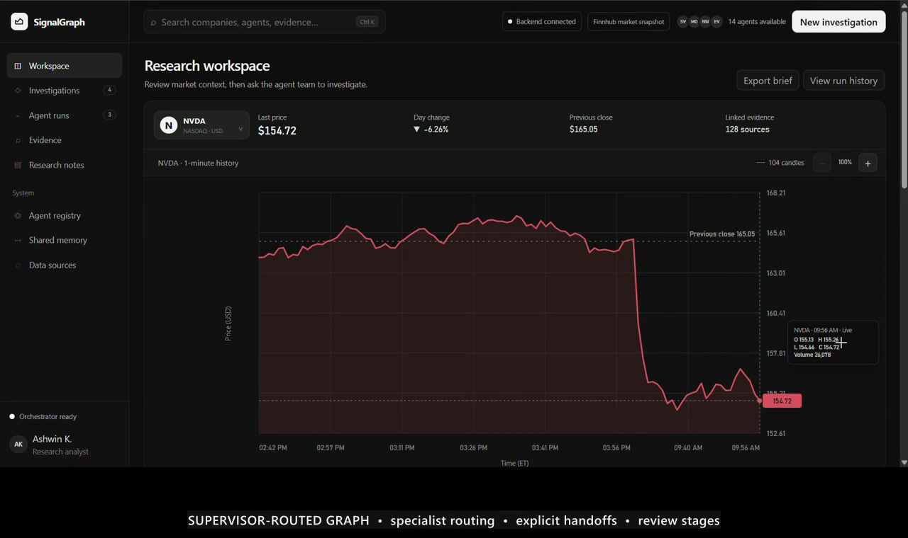
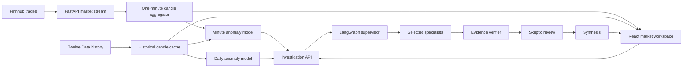

# SignalGraph

SignalGraph is a market investigation workspace built around a simple idea: unusual price movement is only useful when it can be explained with evidence.

The project combines live market data, anomaly detection, and a supervisor-routed agent workflow. It follows trades as they arrive, builds one-minute candles, evaluates unusual movement at minute and daily time scales, and sends investigation questions to the specialists that are actually needed. Their findings are carried forward with evidence references before a final report is produced.

## Demo

[](docs/demo/signalgraph-technical-demo.mp4)

[Watch the 60-second technical demo](docs/demo/signalgraph-technical-demo.mp4)

## What SignalGraph does

- Streams market trades from Finnhub through a FastAPI WebSocket service.
- Aggregates individual trades into forming and finalized one-minute OHLCV candles.
- Combines recent historical candles from Twelve Data with live Finnhub candles for the chart and analysis pipeline.
- Runs per-symbol Isolation Forest models at two different horizons:
  - minute-level models for the latest market movement;
  - daily models for investigations tied to a completed trading date.
- Uses a LangGraph supervisor to choose the smallest useful set of research agents for each question.
- Runs independent research agents in parallel and merges their results through typed shared state.
- Automatically starts a background investigation when a live anomaly passes the score threshold, duplicate check, and per-symbol cooldown.
- Preserves findings, evidence IDs, confidence values, and agent handoffs throughout an investigation.
- Passes research through verification, skeptical review, and synthesis before returning the final report.

## Why this project exists

A price chart can show that something happened, but it cannot explain whether the movement was statistically unusual or what evidence may support an explanation. SignalGraph treats those as separate questions.

The quantitative layer measures the movement. Research agents gather relevant context. Review agents challenge weak claims. The final synthesis is built from the evidence that survived that process.

## System architecture



## Investigation flow

An investigation request contains a question, a stock symbol, and an optional date.

### Live investigation

When no date is supplied, SignalGraph uses the latest in-memory market quote and the most recent minute-level anomaly result. This is intended for questions about current or latest movement.

```json
{
  "question": "What does NVDA's latest movement and anomaly score indicate?",
  "symbol": "NVDA"
}
```

### Completed-day investigation

When a date is supplied, SignalGraph reconstructs that completed trading session and evaluates it with the daily model. This keeps a full-day question separate from a one-minute event.

```json
{
  "question": "What happened to NVDA on this trading day?",
  "symbol": "NVDA",
  "date": "2026-11-12"
}
```

The supervisor then selects the relevant specialists. Research findings move through a review gate, optional verification and skeptical review, and finally the synthesis node.

## Agent workflow

| Agent | Responsibility |
| --- | --- |
| Supervisor | Reads the question and routes it to the smallest useful group of specialists. |
| Market data | Summarizes price, previous close, daily range, and session movement. |
| Technical | Interprets candle structure, return, range, and rolling volatility. |
| Anomaly | Explains the Isolation Forest result and its underlying features. |
| News | Retrieves date-aware company coverage and returns evidence-linked findings. |
| Evidence verifier | Checks whether important claims are supported by the available evidence. |
| Skeptic | Tests alternative explanations and calls out uncertainty. |
| Synthesis | Produces the final answer from the reviewed findings. |

Agent outputs are stored in a typed investigation state. A finding contains the agent's conclusion and confidence, while an evidence record describes the source that supports it. Evidence IDs connect the two without duplicating the full source inside every finding.

## Market and machine-learning pipeline

SignalGraph uses two market-data paths because they serve different purposes:

- **Finnhub** supplies live trades, current quotes, and company news.
- **Twelve Data** supplies the historical candles used for chart history, model preparation, and date-scoped analysis.

The current model set covers NVDA, AMD, MSFT, GOOGL, and META.

### Minute-level model

The minute models were trained on 23,700 feature rows. Each row describes one finalized candle using:

- one-period return;
- high-to-low range;
- candle body and wick proportions;
- opening gap;
- rolling volatility over recent one-minute returns.

### Daily model

The daily models were trained on 12,400 feature rows. Along with candle-shape and return features, they include:

- 20-day rolling volatility;
- relative volume;
- drawdown from the previous 20-day high;
- distance from the previous 20-day average.

Both model families use per-symbol Isolation Forest estimators so that a movement is evaluated against the historical behaviour of the same company.

## Technology

| Layer | Technology |
| --- | --- |
| Frontend | React, Vite, vanilla CSS |
| Backend | FastAPI, Pydantic, WebSockets, HTTPX |
| Agent orchestration | LangGraph, LangChain, Gemini |
| Machine learning | scikit-learn, pandas, joblib |
| Market data | Finnhub, Twelve Data |

## Project structure

```text
SignalGraph/
├── backend/
│   ├── agents/                 # Graph, shared state, agents, schemas and tools
│   ├── api/                    # REST and WebSocket routes
│   ├── ml/                     # Features, training scripts and anomaly detectors
│   ├── providers/              # Finnhub and Twelve Data clients
│   ├── services/               # Market runtime and daily investigation context
│   ├── candle_aggregator.py
│   ├── lifespan.py
│   ├── main.py
│   └── models.py
├── docs/
│   └── demo/                   # Technical demo and thumbnail
├── src/
│   ├── components/             # Dashboard and investigation UI
│   ├── hooks/                  # Live market and historical candle state
│   ├── utils/                  # Candle merging and formatting
│   └── App.jsx
├── .env.example
├── package.json
└── requirements.txt
```

## Running SignalGraph locally

### Prerequisites

- Python 3.12 or newer
- Node.js 18 or newer
- Finnhub API token
- Twelve Data API key
- Google Gemini API key

### 1. Configure the environment

Create a local `.env` file from the provided example:

```powershell
Copy-Item .env.example .env
```

Add the required values:

```env
FINNHUB_API_TOKEN=your_finnhub_token
TWELVE_DATA_API_KEY=your_twelve_data_key
GEMINI_API_KEY=your_gemini_key
GEMINI_MODEL=your_available_gemini_model
```

### 2. Start the backend

```powershell
python -m venv .venv
.\.venv\Scripts\Activate.ps1
pip install -r requirements.txt
python -m uvicorn backend.main:app --reload
```

FastAPI runs at `http://127.0.0.1:8000`. Interactive API documentation is available at `http://127.0.0.1:8000/docs`.

### 3. Start the frontend

Open another terminal in the project directory:

```powershell
npm install
npm run dev
```

The React workspace runs at `http://127.0.0.1:5173`.

## API overview

| Method | Endpoint | Purpose |
| --- | --- | --- |
| `GET` | `/api/health` | Confirms that the backend is running. |
| `GET` | `/api/symbols` | Lists the companies configured in SignalGraph. |
| `GET` | `/api/markets/snapshot` | Returns the latest in-memory quote for each company. |
| `GET` | `/api/markets/{symbol}/quote` | Requests a fresh Finnhub quote for one symbol. |
| `GET` | `/api/markets/{symbol}/history` | Returns recent one-minute historical candles. |
| `WS` | `/ws/market` | Streams live quotes, candle updates, and analysis events. |
| `POST` | `/api/investigations` | Runs a live or date-scoped multi-agent investigation. |

## Future scope

- Complete the cross-market, sector, macroeconomic, filings, regulatory, and risk specialists.
- Stream agent progress, handoffs, evidence, and synthesis results to the React workspace as they are produced.
- Add persistent investigation history and searchable evidence storage.
- Build a repeatable evaluation suite for routing accuracy, citation coverage, unsupported claims, and final-answer quality.
- Add tracing, token and latency monitoring, retry policies, and model fallbacks for production operation.
- Package the services with Docker and deploy a public demonstration environment.
- Expand model coverage while preserving symbol-specific training and data-quality checks.

## Project direction

SignalGraph is designed as an investigation system rather than a trading signal generator. Its purpose is to connect quantitative market movement with traceable research, make the reasoning process visible, and preserve the evidence behind each conclusion.
